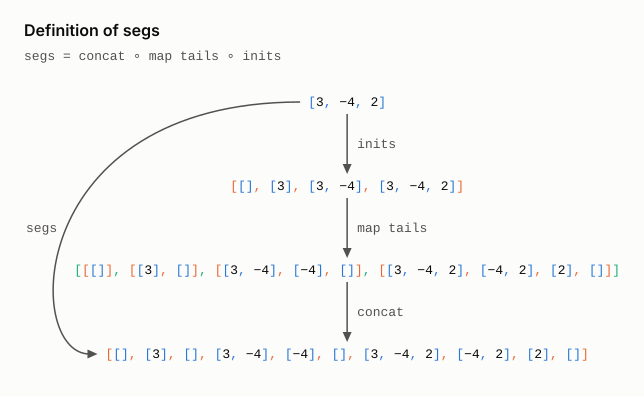
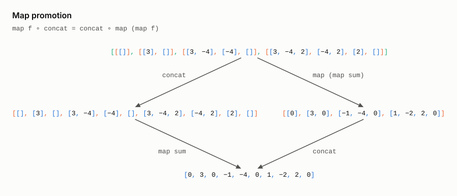
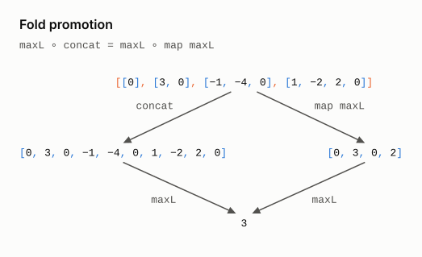
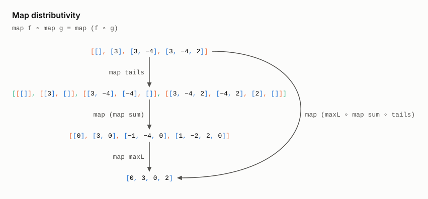
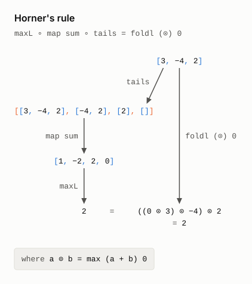
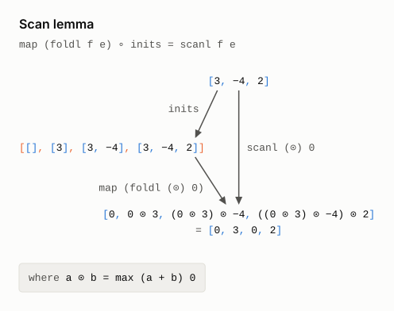
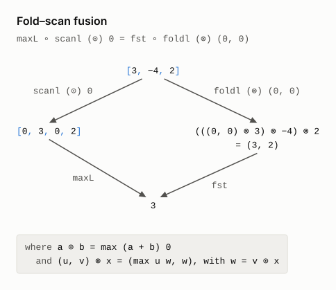
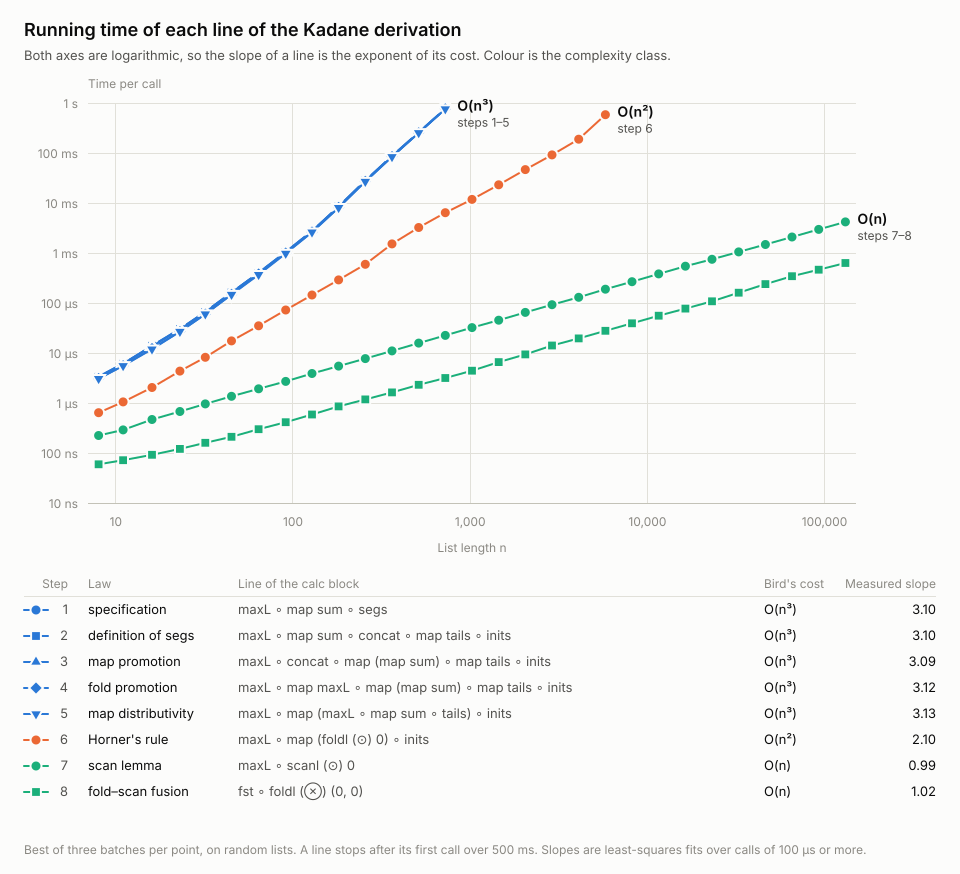

# Bird–Meertens derivations in Lean 4

Each file here starts from an obvious specification. It ends at an efficient
program. Every step in between is a proved law, cited in a `calc` block.

| File | Specification | Result | Needs |
|---|---|---|---|
| [`BirdMeertens/Kadane.lean`](BirdMeertens/Kadane.lean) | `maxL ∘ map sum ∘ segs`, O(n³) | Kadane's `foldl`, O(n) | core Lean |
| [`BirdMeertens/CRC.lean`](BirdMeertens/CRC.lean) | remainder of `M·Xᵏ` by `g` | LFSR, then a table | Mathlib |
| [`BirdMeertens/Adder.lean`](BirdMeertens/Adder.lean) | a carry is the overflow of the columns below | Sklansky carry-lookahead adder, log depth | core Lean |
| [`BirdMeertens/Sorters.lean`](BirdMeertens/Sorters.lean) | four sorter cores from one paper | the four, related by equations | core Lean |

## Kadane's algorithm

This follows Bird's maximum segment sum derivation. Wikipedia shows it in its
[Bird–Meertens formalism](https://en.wikipedia.org/wiki/Bird%E2%80%93Meertens_formalism)
article. The source is Bird, *Algebraic Identities for Program Calculation*, 1989, §8.

`mss_eq_kadane` is one `calc` block. Every line is a runnable program. Every
step cites one law.

```
  maxL ∘ map sum ∘ segs                                 O(n³)
= maxL ∘ map sum ∘ concat ∘ map tails ∘ inits           definition of segs
= maxL ∘ concat ∘ map (map sum) ∘ map tails ∘ inits     map promotion
= maxL ∘ map maxL ∘ map (map sum) ∘ map tails ∘ inits   fold promotion
= maxL ∘ map (maxL ∘ map sum ∘ tails) ∘ inits           map distributivity
= maxL ∘ map (foldl (⊙) 0) ∘ inits                      Horner's rule     O(n²)
= maxL ∘ scanl (⊙) 0                                    scan lemma        O(n)
= fst ∘ foldl (⊗) (0, 0)                                fold–scan fusion  O(n)
```

Here `a ⊙ b = max (a + b) 0`. The pair operator is
`(u, v) ⊗ x = (max u w, w)`, where `w = v ⊙ x`.

- Lists hold `Int`. The empty segment counts, so the answer is never negative.
- `maxL` folds `max` from `0`. That makes `0` its unit.
- Laws used mid-pipeline carry a trailing `∘ g`. Then `rw` can find them.

### Each step, on an example

The Wikipedia article draws an example instance of each law. The diagrams
below do the same for every step of `mss_eq_kadane`, on the list `[3, −4, 2]`.
Each applies its law where the derivation applies it. The left path is the
line before the step, and the right path is the line after it. Both end at the
same value. Steps are numbered as in the table of running times, where step 1
is the specification.

Bracket colour shows depth. Blue brackets hold numbers, orange brackets hold
lists of numbers, and green brackets hold lists of those.

[`diagrams/KadaneDiagrams.lean`](diagrams/KadaneDiagrams.lean) draws them. It
computes every value with the definitions in `Kadane.lean`, and it fails if
the two paths of a diagram disagree. CI redraws the diagrams and checks that
they match the committed files.

```bash
lake exe kadane_diagrams     # redraws the SVGs in bird-meertens/diagrams
```

#### 2. Definition of `segs`

A segment is a suffix of a prefix. The empty segment is a suffix of every
prefix, so it appears four times.

<picture>
  <source media="(prefers-color-scheme: dark)" srcset="diagrams/segs_dark.svg">
  
</picture>

#### 3. Map promotion

`map sum` moves inside `concat`. Each prefix's suffixes are summed as a group.

<picture>
  <source media="(prefers-color-scheme: dark)" srcset="diagrams/map_promotion_dark.svg">
  
</picture>

#### 4. Fold promotion

The largest of all the sums is the largest of each group's largest.

<picture>
  <source media="(prefers-color-scheme: dark)" srcset="diagrams/fold_promotion_dark.svg">
  
</picture>

#### 5. Map distributivity

Three passes over the prefixes become one. `[0, 3, 0, 2]` holds the largest
suffix sum of each prefix. It comes back in steps 7 and 8.

<picture>
  <source media="(prefers-color-scheme: dark)" srcset="diagrams/map_distrib_dark.svg">
  
</picture>

#### 6. Horner's rule

The largest suffix sum is a fold from the left. `⊙` drops `3 + −4` to `0`,
and the suffix starts again. The rule takes its name from polynomials: `+`
distributes over `max` as `·` distributes over `+`. The diagram shows the last
prefix. The derivation applies the rule to every prefix, under `map`. The cost
drops from O(n³) to O(n²).

<picture>
  <source media="(prefers-color-scheme: dark)" srcset="diagrams/horner_dark.svg">
  
</picture>

#### 7. Scan lemma

The left path folds each prefix from scratch. The right path shares the work:
each element is one `⊙` on from the one before. Both paths write out the same
terms, so the lemma holds for any operator. The cost drops from O(n²) to O(n).

<picture>
  <source media="(prefers-color-scheme: dark)" srcset="diagrams/scan_lemma_dark.svg">
  
</picture>

#### 8. Fold–scan fusion

The fold carries a pair. Its second component follows the scan, and its first
keeps the largest so far: `(0, 0)`, `(3, 3)`, `(3, 0)`, `(3, 2)`. So `fst`
gives what `maxL` gives, and no list is built.

<picture>
  <source media="(prefers-color-scheme: dark)" srcset="diagrams/fold_scan_fusion_dark.svg">
  
</picture>

### Running times

[`bench/KadaneBench.lean`](bench/KadaneBench.lean) runs every line of the
`calc` block. It times each line on random lists of growing length.

<picture>
  <source media="(prefers-color-scheme: dark)" srcset="bench/kadane_timings_dark.svg">
  
</picture>

Both axes are logarithmic. A program that costs `c·nᵏ` is then a straight line
of slope `k`. The derivation's three complexity classes show up as three slopes.

- Steps 1–5 lie on top of each other. Their four laws leave the cost unchanged.
- Horner's rule drops a factor of `n`. The scan lemma drops another.
- Fold–scan fusion stays O(n) but runs about 7 times faster. It builds no intermediate list.
- At n = 512 the specification takes 271 ms. The last line takes 2.4 µs, about 110,000 times faster.

| Step | Law | Bird's cost | Measured slope | n = 512 | Largest n | Time there |
|---|---|---|---|---|---|---|
| 1 | specification | O(n³) | 3.10 | 271 ms | 724 | 807 ms |
| 2 | definition of segs | O(n³) | 3.10 | 270 ms | 724 | 807 ms |
| 3 | map promotion | O(n³) | 3.09 | 268 ms | 724 | 803 ms |
| 4 | fold promotion | O(n³) | 3.12 | 266 ms | 724 | 799 ms |
| 5 | map distributivity | O(n³) | 3.13 | 265 ms | 724 | 796 ms |
| 6 | Horner's rule | O(n²) | 2.10 | 3.39 ms | 5,793 | 611 ms |
| 7 | scan lemma | O(n) | 0.99 | 16.5 µs | 131,072 | 4.39 ms |
| 8 | fold–scan fusion | O(n) | 1.02 | 2.42 µs | 131,072 | 661 µs |

The slopes of the first six lines sit a little above 3 and 2. `inits` keeps
all `n²/2` prefix cells alive. Memory traffic then likely grows faster than the
operation count.

`lines_eq_mss` proves that every timed program equals `mss`. Its proof replays
the laws, so the benchmark cannot time a mistyped line. Each run also checks
that all eight lines agree on every input.

Each point is the fastest of three batches. A batch repeats the call until it
lasts at least 20 ms. A line stops after its first call over 500 ms. A slope is
a least-squares fit of `log t` on `log n`, over calls of 100 µs or more.

These numbers come from one run on an Intel Xeon at 2.60 GHz, a GCP VM, with
Lean 4.28.0, before these examples moved to Lean 4.34.1. Absolute times vary
by machine. The slopes should change little.

```bash
lake exe kadane_bench        # about 40 seconds
lake exe kadane_bench 50     # stop each line at 50 ms instead
```

Run it from the repository root. It writes every measurement to
[`bench/kadane_timings.csv`](bench/kadane_timings.csv), then redraws both SVGs.

## A CRC

The textbook CRC is algebra. Read the message bits as a polynomial `M` over
GF(2). The CRC is the remainder of `M·Xᵏ` divided by a generator `g`.
Hardware never divides. It clocks bits through a `k`-bit shift register.

`crc_eq_lfsr` derives that register, for every generator. The right column is
the state each line keeps while it streams the message.

```
  (· %ₘ g) ∘ (· * Xᵏ) ∘ msgPoly                                    whole message
= (· %ₘ g) ∘ (· * Xᵏ) ∘ foldl horner 0   Horner's rule             n coefficients
= (· %ₘ g) ∘ foldl hornerShift 0         fold fusion: shift        n + k
= foldl hornerMod 0                      fold fusion: reduction    k
= toPoly ∘ foldl lfsrStep 0              fold fusion: refinement   k bits
```

`crcBytes_eq_table` goes on to Sarwate's table, one lookup per byte, for any
width `k ≥ 8`.

```
  crc ∘ flatten ∘ map bitsOf
= toPoly ∘ foldl lfsrStep 0 ∘ flatten ∘ map bitsOf    the derivation above
= toPoly ∘ foldl (foldl lfsrStep) 0 ∘ map bitsOf      fold over concatenation
= toPoly ∘ foldl byteStep 0                           fold–map fusion
= toPoly ∘ foldl tableStep 0                          Sarwate's table
```

The table step holds because reduction modulo `g` is linear. Its proof is a
short `calc` in `byteStep_eq_tableStep`.

The file also connects the derivation to this repo and to the CRC catalogue.

| Theorem | Says | Proved by |
|---|---|---|
| `crc8Next_eq_lfsrStep` | [`crc8.sv`](crc8.sv) is the derived LFSR | `bv_decide` |
| `crc8_rtl_correct` | after reset to `0xFF`, `crc8.sv` holds `(0xFF·Xⁿ + M·X⁸) mod (X⁸ + X² + X + 1)` | the laws |
| `xmodem_check` | the spec gives CRC-16/XMODEM's `0x31C3` on `"123456789"` | kernel `decide` |
| `smbus_check` | the spec gives CRC-8/SMBUS's `0xF4` | kernel `decide` |

The check values are theorems about the specification. No polynomial division
ever runs. The kernel runs the derived table loop instead.

## Why the CRC suits a talk

- Every hardware engineer knows the spec. It fits on one line.
- One law, fold fusion, does three jobs: a shift, a reduction, a change of representation.
- Bits meet polynomials in one lemma, `toPoly_lfsrStep`. It covers one clock. Fusion does the induction.
- The derivation ends at RTL in this repo, and at published check values.
- It is small. `CRC.lean` is about 400 lines, with 38 theorems.

A possible running order for slides:

1. The spec: `(M·Xᵏ) mod g`.
2. Horner's rule. Now a loop, but its state grows with the message.
3. Two fusions. The state is now bounded by `k`, but still a polynomial.
4. Data refinement to a `k`-bit register. The one-clock lemma.
5. Bytes. Two list laws, then Sarwate's table from linearity.
6. The payoff. `crc8.sv` is that LFSR, and the check values are theorems.

## A carry-lookahead adder

The carry into column `i` of a binary addition is set when the low `i` columns,
plus the carry in, overflow `i` bits. That is the whole specification. A
ripple-carry adder computes the carries one column at a time. A carry-lookahead
adder computes them with a parallel prefix network.

`carries_eq_prefixNet` derives the second from the first. Columns run least
significant first. The right column is the depth of the carry chain for `n`
columns.

```
  map (carryOut c) ∘ inits                                  the specification
= map (foldl carry c) ∘ inits                               full-adder law
= scanl carry c                                             scan lemma          n
= scanl ev c ∘ map gp                                       carry = g ∨ (p ∧ c)
= map fst ∘ scanl (⊛) (c, false) ∘ map gp                   scan fusion
= map fst ∘ scan1 (⊛) ∘ ((c, false) :: ·) ∘ map gp          definition of scan1
= map fst ∘ prefixNet (⊛) ∘ ((c, false) :: ·) ∘ map gp      parallel prefix     ⌈log₂ (n + 1)⌉
```

Here `gp (a, b) = (a ∧ b, a ⊕ b)` gives a column's generate and propagate bits.
The carry operator is `(g₁, p₁) ⊛ (g₂, p₂) = (g₂ ∨ (p₂ ∧ g₁), p₁ ∧ p₂)`. It is
associative, and that is all the last step needs. The carry in enters as an
extra column that generates `c`.

The scan lemma is the one from the Kadane derivation. Scan fusion does the job
that fold fusion did for the CRC.

`prefixNet` is Sklansky's network. It scans both halves at once. Then it
combines the left half's total into every result of the right half. It takes
its operator as an argument, so the same code has three readings.

| Run it on | It computes | Theorem |
|---|---|---|
| bits, with `⊛` | the carries | `cla_correct`: the output, read as a number, is the sum |
| arrival times, with `later t u = max t u + 1` | each output's depth | `prefixNet_depth`: at most `⌈log₂ n⌉` levels; `serial_depth`: the serial scan needs `n - 1` |
| symbolic gates | a netlist | `claNet_correct`: the netlist adds |

`lake exe adder_netlist` prints the netlist as Verilog. Each distinct gate
becomes one wire. The 32-bit adder is
[`netlist/sklansky_adder_32.v`](netlist/sklansky_adder_32.v).

| Width | Ripple gates | Ripple depth | Sklansky gates | Sklansky depth |
|---|---|---|---|---|
| 8 | 48 | 17 | 55 | 9 |
| 16 | 96 | 33 | 131 | 11 |
| 32 | 192 | 65 | 307 | 13 |
| 64 | 384 | 129 | 707 | 15 |

Depth counts two-input gates on the longest path. Sklansky buys logarithmic
depth with more gates: 1.6 times as many at 32 bits, 1.8 at 64. Both netlists come from lines of the
derivation: `rippleNet` from the third, `claNet` from the last.

Only the Verilog printer is unverified. Two outside tools check what it prints.

```bash
make -C bird-meertens/netlist lint     # Verilator with every warning on: clean
make -C bird-meertens/netlist equiv    # Yosys SAT: the adder equals + for every input
```

The SAT proof passes at widths 8, 32 and 64. A netlist with one gate flipped
fails it.

### From ripple-carry to carry-lookahead, directly

`refine_cla_from_ripple_carry` relates the two adders themselves. It starts
from the ripple-carry adder as Lava builds it: `row fullAdd`, a chain of full
adders. It ends at `cla`. Neither end mentions the specification.

```
  snoc ∘ row fullAdd c                                             a row of full adders   n
= adder (scanl carry c)                                            row law
= adder (scanl ev c ∘ map gp)                                      carry = g ∨ (p ∧ c)
= adder (map fst ∘ scanl (⊛) (c, false) ∘ map gp)                  scan fusion
= adder (map fst ∘ scan1 (⊛) ∘ ((c, false) :: ·) ∘ map gp)         definition of scan1
= adder (map fst ∘ prefixNet (⊛) ∘ ((c, false) :: ·) ∘ map gp)     parallel prefix        ⌈log₂ (n + 1)⌉
= cla c                                                            definition of cla
```

`adder net xs = sumBits xs (net xs)` wraps a carry network `net`. It adds one
XOR per column, then the carry out. `snoc` puts the row's last carry on top of
its sum bits.

The row law is the one new step. A row's carries are a scan, and each output
reads its column and the carry into it. After it come the steps above, under
`adder`. The netlist section's `rippleNet` is the second line, `adder (scanl
carry c)`, built from gates.

### Why the adder suits a talk

- The spec is the definition of a carry. It assumes nothing about circuits.
- The derivation reuses two laws from the other examples: the scan lemma and fusion.
- Associativity is the reason the adder can be parallel. The proof makes that visible.
- A second calculation turns the textbook row of full adders into Sklansky's adder.
- One Lean function yields a proof, a depth analysis and a netlist. That is Lava's idea, checked.

## Four sorter cores, related

Claessen, Sheeran and Singh, *The Design and Verification of a Sorter Core*
(CHARME 2001, LNCS 2144), build four sorters for a Virtex-II from Lava
connection patterns. [`BirdMeertens/Sorters.lean`](BirdMeertens/Sorters.lean)
copies their definitions and relates the four by calculation.

All four mergers fit one schema, `fly P L`. It places a connection pattern `P`
around the merger of half the size, then adds a last column `L`.

| Merger | `P` | `L` |
|---|---|---|
| `bfly`, Batcher's bitonic merger | `ilv` | `evens` |
| `mergeOE`, Batcher's odd–even merger | `ilv` | `mid ∘ evens` |
| `vfly`, the balanced merger of Dowd et al. | `vee` | `evens` |
| `qfly`, the merger of Canfield and Williamson | `que` | `mid ∘ evens` |

The main results hold for any comparator that keeps lengths and is symmetric,
`f [a, b] = f [b, a]`. The equalities are on lists of length `2ⁿ`.

```
sortB  (n + 1) = two (sortB n)  >-> mergeB  (n + 1)    where mergeB n = parl id reverse >-> bfly n
sortOE (n + 1) = two (sortOE n) >-> mergeOE (n + 1)
qfly n  = unriffle >-> mergeOE n
vfly n  = unriffle >-> mergeB n
sortQ n = hrep n (unriffle >-> mergeOE n)
sortV n = hrep n (unriffle >-> mergeB n)
```

So all four cores come from Batcher's two mergers, used in two ways.

| Merger | Recursive: sort both halves, then merge | Periodic: `n` mergers, each behind `unriffle` |
|---|---|---|
| bitonic, `mergeB` | `sortB` | `sortV` |
| odd–even, `mergeOE` | `sortOE` | `sortQ` |

Canfield and Williamson titled their paper "a sequential sorting network
analogous to the Batcher merger". Here the analogy becomes an equation.
`qfly_eq_unriffle_mergeOE` is one `calc` block; `f` is the comparator.

```
  qfly (n + 2)
= que (qfly (n + 1)) >-> mid (evens f)                                      definition
≈ que (unriffle >-> mergeOE (n + 1)) >-> mid (evens f)                      induction
≈ que unriffle >-> que (mergeOE (n + 1)) >-> mid (evens f)                  que is a functor
≈ ilv unriffle >-> two unriffle >-> two (mergeOE (n + 1)) >-> ilv riffle >-> mid (evens f)
                                                                            ilv riffle undoes ilv unriffle
≈ unriffle >-> unriffle >-> two (mergeOE (n + 1)) >-> ilv riffle >-> mid (evens f)   W3
≈ unriffle >-> unriffle >-> two (mergeOE (n + 1)) >-> riffle >-> mid (evens f)       W4, f symmetric
= unriffle >-> mergeOE (n + 2)                                              definition
```

`vfly_eq_unriffle_mergeB` has the same shape. It uses W5, and the fact that a
butterfly of symmetric components ignores a reversal of its input.

Four wiring laws carry the proofs. Each holds on every list of length `4m`.

| Law | Statement |
|---|---|
| W3 | `ilv unriffle >-> two unriffle = unriffle >-> unriffle` |
| W4 | `ilv riffle = riffle >-> mid (altAux true)` |
| W5 | `alt >-> ilv unriffle >-> ilv (parl id reverse) = unriffle >-> parl id reverse >-> oddsRev` |
| W6 | `ilv (two g) = two (ilv g)` |

They are proved by splitting a list into four interleaved quarter-lists. Then
each wiring only rearranges or reverses the quarters. No position arithmetic is
needed.

Symmetry matters twice. The last column absorbs swaps inside its pairs: that is
the step after W4. And `oddsRev` vanishes into a butterfly. With an asymmetric
component, the `qfly` identity already fails at 4 inputs.

The paper's own lemma from §6, `que (ilv f) = ilv (ilv f)`, follows from W3 and
W6 (`que_ilv`). Its §5 checks are repeated. A kernel proof shows that all four
sorters sort every 4-bit input. Evaluation covers every 8-bit input. The
counterexample `[0, 1, 0, 1]` shows that `bflyCompose` is not a sorter.

### How the identities were found

They were found by testing before they were proved. Two comparator networks are
equal exactly when they agree on every 0–1 input. So exhaustive 0–1 testing
compared candidate equations up to 16 inputs. A symbolic symmetric component
extended the tests to 64 inputs. A search over all 8! input wirings
at 8 inputs showed two families: `{bfly, vfly}` and `{mergeOE, qfly}`. Within a
family, one merger is the other behind a wiring. No wiring links the families.

## Trust

| Theorems | Axioms |
|---|---|
| Kadane | `propext`, `Quot.sound` |
| CRC derivation and check values | the above, plus `Classical.choice` from Mathlib |
| `crc8Next_eq_lfsrStep`, `crc8_rtl_correct` | the above, plus `crc8Next_eq_lfsrStep._native.bv_decide.ax_1_7`, the axiom with which `bv_decide` trusts its compiled check |
| Adder: `carries_eq_prefixNet`, `cla_correct`, `claNet_correct` | `propext`, `Classical.choice`, `Quot.sound` |
| Adder: `refine_cla_from_ripple_carry`, `rippleNet_correct`, `prefixNet_depth`, `serial_depth` | `propext`, `Quot.sound` |
| Sorters: `qfly_eq_unriffle_mergeOE`, `vfly_eq_unriffle_mergeB`, `sortQ_eq`, `sortV_eq`, `que_ilv` | `propext`, `Classical.choice`, `Quot.sound` |
| Sorters: `sortB_eq` | `propext`, `Quot.sound` |

`crc8Next` is transcribed from `crc8.sv` by hand. It is not the generated model.
The adder's Verilog printer is unverified. Verilator and Yosys check its output.

## Build

These examples share the repository's one `lakefile.toml`, with Lean and
Mathlib `v4.34.1`. It builds the `BirdMeertens` library with `autoImplicit` on
and a larger `maxRecDepth`, as these files expect. Run every command from the
repository root.

```bash
lake exe cache get
lake build BirdMeertens kadane_bench kadane_diagrams adder_netlist   # `lake build` builds them too
lake exe kadane_bench      # the timings and plots; needs only core Lean
lake exe kadane_diagrams   # the diagrams of the Kadane laws; needs only core Lean
lake exe adder_netlist     # the adder as Verilog; then make -C bird-meertens/netlist lint equiv
```
